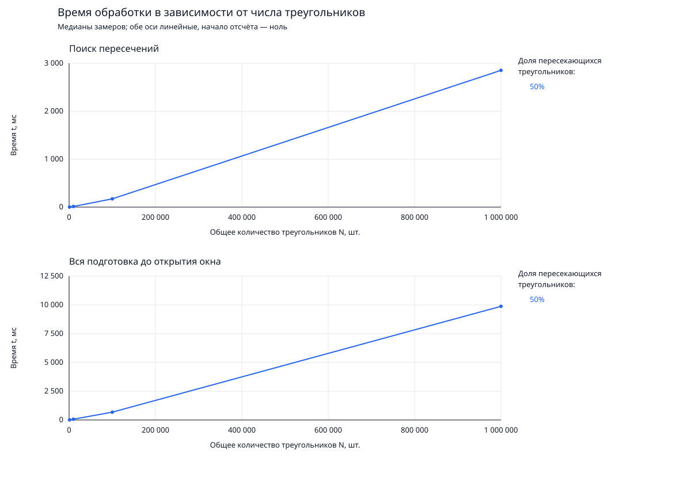

# Triangles

Приложение на C++ для поиска пересечений треугольников в трёхмерном пространстве
и визуализации результата. Пересекающиеся треугольники выделяются красным,
непересекающиеся — серым.

## Быстрый запуск

Для Linux x86_64 нужен Nix с поддержкой `nix-command` и `flakes`.

```bash
nix develop
cmake --preset release
cmake --build --preset release
nixGLIntel ./build/release/triangles inputs/example.txt
```

В комплекте есть `inputs/example.txt`: два пересекающихся треугольника и один
отдельный. Пример можно заменить своим файлом.

## Сборка

Все зависимости предоставляет `nix develop`. Выбери конфигурацию:

| Preset | Назначение | Каталог |
|---|---|---|
| `release` | Приложение с оптимизацией и тесты | `build/release` |
| `debug` | Приложение для отладки и тесты | `build/debug` |
| `profile` | Приложение с оптимизацией и отладочными символами, без тестов | `build/profile` |
| `quality` | Приложение, тесты и compilation database для clang-tidy | `build/quality` |


## Запуск

```text
triangles <input-file> [--no-visualization]
```

С визуализацией:

```bash
nixGLIntel ./build/release/triangles inputs/example.txt
```

Без окна:

```bash
./build/release/triangles inputs/example.txt --no-visualization
```

При использовании другой конфигурации замени `build/release` на соответствующий
каталог из таблицы.

В стандартный вывод (`stdout`) записываются индексы всех треугольников,
пересекающихся хотя бы с одним другим: по одному индексу на строку, без повторов,
по возрастанию. Нумерация начинается с нуля и соответствует порядку во входном
файле. Если пересечений нет, вывод пустой. Для `inputs/example.txt` результат:

```text
0
1
```

Статистика и время обработки выводятся в `stderr`.

| Управление | Действие |
|---|---|
| ЛКМ + движение мыши | Вращение камеры вокруг сцены |
| ПКМ + движение мыши | Перемещение камеры |
| Колесо мыши | Приближение и отдаление |

## Формат входного файла

Перед вершинами каждого полигона указывается их количество, затем идут
координаты `x y z`. Значения разделяются пробельными символами.

```text
3
0 0 0
2 0 0
0 2 0

3
0.5 0.5 0
1.5 0.5 0
0.5 1.5 0
```

Текущий расчёт поддерживает треугольники — по три вершины на объект.
Касания считаются пересечениями.

## Генерация данных

```bash
python3 inputs/generate_input.py 10000 inputs/input_10000.txt --seed 42
nixGLIntel ./build/release/triangles inputs/input_10000.txt
```

По умолчанию половина треугольников участвует в пересечениях. Генератор создаёт
изолированные пары в пространственных ячейках: часть пар пересекается,
остальные разделены.

| Параметр | По умолчанию | Назначение |
|---|---|---|
| `--intersecting-fraction` | `0.5` | Доля пересекающихся треугольников в режиме `mixed` |
| `--mode` | `mixed` | Контролируемые пары (`mixed`) или случайные вершины (`random`) |
| `--min`, `--max` | `-10`, `10` | Диапазон координат |
| `--seed` | Не задан | Воспроизводимость генерации |

Например, миллион треугольников с долей пересекающихся 20%:

```bash
python3 inputs/generate_input.py 1000000 inputs/input_1000000.txt \
  --intersecting-fraction 0.2 --seed 42

nixGLIntel ./build/release/triangles inputs/input_1000000.txt
```

## Тесты

```bash
cmake --preset debug
cmake --build --preset debug
ctest --preset debug
```

Для проверки оптимизированной сборки используй `release` вместо `debug`.
Тесты охватывают геометрию, AABB, BVH, поиск пересечений мира и разбор входа.

## Измерение производительности

```bash
cmake --preset profile
cmake --build --preset profile

python3 scripts/benchmark_intersections.py \
  --counts 100 500 1000 2500 5000
```

Скрипт использует `build/profile/triangles`, запускает приложение без окна
и строит зависимость времени от общего количества треугольников. Отдельные
кривые соответствуют разным долям пересекающихся объектов. Без `--counts`
серия продолжается до миллиона.

Результаты сохраняются в `build/benchmark-intersections`:

- `samples.csv` — отдельные замеры;
- `medians.csv` — медианы;
- `timings.svg` — графики: X — число треугольников, Y — время в миллисекундах,
  обе шкалы линейные.

По умолчанию выполняются один прогрев и три измеряемых запуска на набор.
Настройки доступны через `--help`. Бенчмарк использует изолированные копланарные
пары; результаты зависят от распределения геометрии.

Перестроить график без повторных расчётов:

```bash
python3 scripts/benchmark_intersections.py \
  --plot-from build/benchmark-intersections/medians.csv
```

### Результаты измерений

Замер от 7 ноября 2026 года: AMD Ryzen 7 8845H, Linux x86_64,
Clang 18.1.8, preset `profile` (`RelWithDebInfo`, `-O2 -g -DNDEBUG`).
Доля пересекающихся треугольников — 50%, seed — 42. Для каждого размера
выполнены один прогрев и три измеряемых запуска; в таблице приведены медианы.

| Треугольников | Построение BVH и поиск, мс | Вся обработка до окна, мс |
|---|---:|---:|
| 1 000 | 1.130 | 9.031 |
| 10 000 | 13.492 | 67.795 |
| 100 000 | 172.364 | 679.439 |
| 1 000 000 | 2852.950 | 9876.610 |

Время поиска включает подготовку геометрии и построение BVH. Общее время
также включает чтение, разбор файла, создание мира и подготовку сцены;
отрисовка не измеряется.

[Все замеры](docs/benchmarks/2026-11-07/samples.csv) ·
[Медианы](docs/benchmarks/2026-11-07/medians.csv) ·
[Условия измерения](docs/benchmarks/2026-11-07/environment.json)



Повторить этот эксперимент:

```bash
python3 scripts/benchmark_intersections.py \
  --counts 1000 10000 100000 1000000 \
  --fractions 0.5 --seed 42 --warmups 1 --repeats 3
```

## Зависимости

| Библиотека | Назначение |
|---|---|
| [generalFunctions](https://github.com/DREC-Drillers/generalFunctions) | Геометрия, лексер, чтение файлов, бинарное дерево |
| [3D-Visualizer](https://github.com/DREC-Drillers/3D-Visualizer) | Сцена, камера, окно и отрисовка |
| GoogleTest | Тестирование |

Nix предоставляет Clang/LLVM 18, CMake 3.28+, Ninja, Python и необходимые
библиотеки. Ревизии зависимостей закреплены в `flake.lock`.

Обновить одну из зависимостей:

```bash
nix flake lock --update-input generalFunctions
nix flake lock --update-input visualizer
```

После обновления выйди из `nix develop` и зайди снова.
